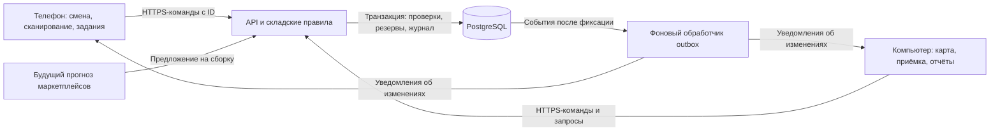
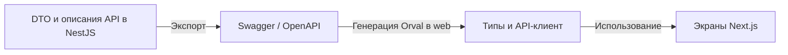

# Архитектура и модель данных

## Фактически реализованный первый срез

В репозитории уже есть локальная интерактивная версия. Её фактическая архитектура и ограничения записаны в ADR-001–045 и README: Yarn/Turbo, FSD, Next.js/NestJS, OpenAPI→Orval, настоящий PostgreSQL через pg. Ниже описана более широкая целевая архитектура; ещё не реализованные элементы не считаются готовыми.

Целевая схема ниже шире существующего кода. В локальной реализации уже зафиксированы Yarn Classic, Turborepo, Next.js16, NestJS11 и отдельный PostgreSQL. Адреса ярусов, профили упаковки, физические ограничения и перемещения реализованы по ADR-005–008. Помещение, входы, проходы, поворот и восстановимое удаление реализованы по ADR-009–012. Несколько помещений и коридоров, рисование по сетке и привязка проёмов реализуются по ADR-013–015. Экранный масштаб и небольшие секции описаны в ADR-016–018. Документы приёмки, подтверждённое размещение, архив и серверный баланс реализованы по ADR-019–021. Свободный захват заданий, назначение после создания и автоматический цикл короба описаны ADR-022–024. Общая паллета накопления со смешанными тематиками и второстепенное размещение описаны ADR-025–027. Количественный журнал с начальным остатком и защищённые корректировки описаны ADR-036–038. Вход, серверные сессии и роли реализованы по ADR-039–041. История смен, факты работы и периодный отчёт реализованы по ADR-042–043. Документы инвентаризации, версии ячеек и подтверждённые корректировки описаны в ADR-044–045.

## 1. Общий подход

Согласован отдельный монорепозиторий `artmate-wms`: `apps/web` на Next.js и `apps/api` на NestJS. Веб-интерфейс объединяет административные и мобильные маршруты. NestJS генерирует Swagger/OpenAPI из серверных DTO и описаний endpoints. Веб через Orval генерирует типы и API-клиент из этой спецификации; отдельного пакета вручную синхронизируемых типов API нет.

Для backend предлагается модульный монолит с одной PostgreSQL. Домен складского учёта общий для всех экранов и будущих интеграций. Монорепозиторий описывает организацию кода; web и API остаются отдельными приложениями с собственным запуском и сборкой.

Для MVP не нужны микросервисы, отдельная база аналитики, Kafka, Kubernetes, полноценный event sourcing или приложение для каждой мобильной ОС. При этом операции учёта имеют неизменяемый журнал и транзакционные проверки.



Клиенты не рассчитывают окончательные остатки самостоятельно. Любое изменение проходит через сервер. Уведомления отправляются после фиксации транзакции, поэтому экран не видит операцию, которая затем откатилась.

## 2. Согласованный стек и остальные технологические предложения

В соседнем `artmate-monorepo` локально прочитаны корневой `package.json` и манифесты `apps/admin`, `apps/api`, `apps/site`: используются TypeScript, React/Next.js, NestJS и Prisma. Это факт о локальном проекте на 23 октября 2026 года, не рекомендация конкретных версий.

Владелец выбрал монорепозиторий, Next.js, NestJS и цепочку генерации Swagger/OpenAPI → Orval. В таблице эти решения зафиксированы; остальные компоненты остаются проектными предложениями:

| Слой | Предложение | Основание |
|---|---|---|
| Организация кода | Отдельный монорепозиторий artmate-wms | Согласовано владельцем; apps/web, apps/api, packages/* |
| Web | React + Next.js + TypeScript | Next.js согласован владельцем; мобильные и административные экраны в apps/web |
| API | NestJS + TypeScript | NestJS согласован владельцем; apps/api содержит домен команд и прав |
| Типы и API-клиент web | Swagger/OpenAPI из NestJS → Orval | Согласовано владельцем; источник описания API — backend, генерация — на стороне web |
| База | PostgreSQL | Транзакции, ограничения, блокировки, журнал и отчёты |
| Доступ к данным | Prisma либо текущий проверенный подход Artmate | Выбрать после проверки транзакционных требований |
| Карта | SVG для первых реальных масштабов | Вид сверху, выбор объектов, масштаб, интерактивность; библиотека не обязательна |
| Состояние запросов | Привычный для проекта клиент запросов | Инвалидация по серверным событиям |
| Онлайн-обновления | SSE с повторной синхронизацией; polling как запасной путь | Однонаправленные обновления статусов достаточны |
| Этикетки | Генерация QR и PDF | Непривязанный к одной модели принтера путь |
| Тесты | Проверки домена + реальная PostgreSQL + браузерные сценарии | Основные риски находятся в транзакциях и физических операциях |

Менеджер пакетов и инструмент сборки монорепозитория выбрать перед созданием каркаса; совместимость с подходом Artmate проверить отдельно. Настроить workspaces и общие команды dev/build/lint/typecheck/test. Версии выбрать при создании приложения и зафиксировать единый корневой lockfile. Общую базу с Artmate, копирование секретов или прямой импорт его приватных модулей этот план не предполагает.

### 2.1. Генерация API для веба

1. В NestJS описывать DTO, параметры, успешные ответы, ошибки, авторизацию и устойчивые operationId. Серверная проверка входных данных остаётся в NestJS.
2. Из NestJS воспроизводимо экспортировать Swagger/OpenAPI-спецификацию. Генерация для сборки и CI не зависит от доступности рабочего сервера склада.
3. В apps/web настроить Orval на эту спецификацию и генерировать типы и API-клиент в src/api/generated. Конкретный тип клиента и расположение артефакта спецификации уточняются при создании каркаса.
4. Настройки транспорта, авторизацию, request_id и стабильный ключ повторяемой команды подключать через отдельный адаптер вне сгенерированных файлов. Сетевой повтор складской команды сохраняет прежний ID.
5. При изменении API повторять цепочку экспорта и генерации, затем проверять типы и сборку web. Сгенерированные файлы вручную не редактировать; DTO и клиентские типы независимо не дублировать.
6. В CI выполнять экспорт спецификации, генерацию Orval и typecheck. Если артефакты хранятся в Git, проверять отсутствие расхождения после генерации; если нет — генерировать перед сборкой.
7. Перед приёмкой API проверять соответствие фактических ответов NestJS опубликованной спецификации: сгенерированные TypeScript-типы не заменяют эту проверку.



Источник описания API — NestJS. Веб получает типы и функции запросов генерацией; складская логика исполняется на backend.

## 3. Модули

1. Identity: пользователи, роли, сессии, устройства.
2. Catalog: SKU, штрихкоды, упаковки, габариты.
3. Warehouse: план, зоны, адреса, версии карты, профили вместимости.
4. Labels: выдача идентификаторов, QR, PDF, повторная печать.
5. Receiving: поставки, фактическая приёмка, партии, паллеты.
6. Inventory: остатки по партиям, контейнеры, журнал, карантин.
7. Allocation: FIFO, резервы товара, резервы адресов и объяснения отказа.
8. Work: задания, назначение, смены, паузы и передача.
9. Assembly: открытые короба, сканирования, НЗП, закрытие, состав.
10. Movement: перемещения коробов/паллет, спуск, возврат, доступность.
11. Shipping: ручные отгрузки, отбор, консолидация, отправка.
12. Counting: пересчёты, расхождения и корректировки.
13. Reporting: текущая работа, остатки, производительность.
14. Operations: аудит, outbox, мониторинг, резервное копирование.
15. Planning: позднее — предложения из прогноза; сейчас ручной вход в Work.

Модули вызывают доменные сервисы, а не редактируют таблицы чужого процесса напрямую. В MVP это границы кода внутри одного приложения, а не сетевые сервисы.

## 4. Основные сущности

### 4.1. Справочники и карта

| Таблица / сущность | Основные поля и ограничения |
|---|---|
| warehouses | id, название, timezone, статус |
| zones | id, warehouse_id, тип, название, геометрия |
| layout_versions | id, warehouse_id, draft/published/archived, автор, время публикации |
| layout_objects | версия, тип, координаты, размеры, поворот, ссылка на реальную секцию/адрес |
| rack_sections | id, склад, зона, код секции, сторона доступа |
| rack_levels | id, section_id, номер, высота и ограничения яруса |
| locations | id, склад, зона, section/level, уникальный адрес, габариты, active/blocked/archived, версия |
| capacity_profiles | адрес/тип адресов, форма хранения, габариты паллеты, коробов в слое, слоёв, ограничения |
| skus | id, артикул, тематика, активность |
| sku_barcodes | уникальный нормализованный код, sku_id, тип; возможность нескольких кодов одного SKU |
| packaging_versions | sku_id, номер версии, штук в коробе, размеры короба, масса при наличии, активность |

Геометрия версии карты и постоянный ID адреса разделены. Новый план не создаёт заново весь складской учёт. Исторические операции ссылаются на постоянный адрес и сохраняют снимок его названия на момент операции.

### 4.2. Поступление и физические контейнеры

| Сущность | Основные поля и ограничения |
|---|---|
| receipts | номер, источник, ожидаемая дата, статус, автор |
| receipt_lines | receipt_id, sku_id, ожидаемое и принятое количество |
| lots | sku_id, приёмка/источник, производственный номер/дата при наличии, received_at, fifo_sequence, происхождение известно/неизвестно |
| handling_units | id, тип raw_pallet/finished_pallet/box, sku_id, QR-ID, lifecycle_status, version |
| pallet_details | handling_unit_id, фактические габариты, масса при наличии, роль accumulation/picking/reserve/blocked |
| box_details | handling_unit_id, packaging_version_id, expected_units_snapshot, assembly_task_id, статус |
| box_lot_contents | box_id, lot_id, quantity; состав закрытого короба, сумма равна фактической комплектации |
| container_placements | handling_unit_id, direct_location_id либо parent_pallet_id; при переносе custody/movement_id |
| labels | сущность, постоянный код, версия печатного шаблона, история печати |

received_at — фактическая дата поступления партии на склад и основа FIFO; время регистрации операции хранится отдельно. Внутри одной партии время упаковки даёт мягкий приоритет. Разные партии одного SKU на готовой паллете допустимы при нехватке старой партии; основание смешения сохраняется, количественный состав не теряется.

На паллете готовой продукции лежат дочерние короба, но отдельного товарного остатка «содержимое паллеты» поверх их остатков не создаётся. Иначе товар будет посчитан дважды.

Для каждого контейнера существует ровно один текущий путь местоположения: прямой адрес или родительская паллета, чей адрес наследуется. На время переноса есть явно заданный физический держатель/статус. Циклы вложенности запрещены. Короб не может одновременно быть на паллете и на независимом адресе.

Входящая паллета содержит раскраски непосредственно. Готовая паллета содержит короба. В MVP смешение этих двух форм на одной паллете запрещено.

Поддон можно использовать повторно, но новый цикл загрузки не должен оживлять прежнее содержимое по старой этикетке. Учет физического многоразового поддона при необходимости отделяется от ID конкретной загрузки.

### 4.3. Остатки, резервы и журнал

| Сущность | Основные поля и ограничения |
|---|---|
| inventory_balances | warehouse_id, sku_id, lot_id, owner_container_id, stage, quantity, version |
| inventory_operations | id, тип, документ-основание, actor_id, shift_id, committed_at, причина, correlation_id |
| inventory_entries | operation_id, balance/account key, signed_quantity; целые штуки |
| movements | контейнер, исходное и целевое место/родитель, статус, исполнитель, подтверждения |
| stock_reservations | task/shipment, lot/container, количество, active/consumed/released, version |
| capacity_reservations | location/pallet, паллетоместа/короба/габаритный профиль, назначение, владелец, статус |
| blocked_inventory | контейнер/партия/адрес, причина, автор, время и снятие блокировки |
| fifo_exceptions | операция, пропущенный старый запас, выбранный запас, причина, разрешивший пользователь |

Единица базового учёта — целая раскраска. Количество готовых коробов считается по уникальным закрытым коробам. Упаковка не порождает новые раскраски.

Стадии: raw, wip, finished, quarantine. Нахождение в зоне отгрузки сохраняет finished до отправки. Для отчёта «отобрано на отгрузку» используются размещение и резерв, а не дополнительный дублирующий товарный остаток.

Журнал количественных движений и оперативные остатки обновляются одной транзакцией. Для внутреннего преобразования сумма количественных проводок по каждой партии равна нулю. Приёмка имеет внешний источник, отгрузка и списание — внешнее выбытие. Исторические операции не редактируются.

Перемещение целой паллеты меняет её путь местоположения, а не количество дочерних коробов. Событие сохраняет исходный и целевой адреса. Для восстановления истории местоположений нужны и журнал количеств, и история placements/movements.

box_lot_contents — проверяемый снимок происхождения закрытого короба. Его нельзя добавлять к inventory_balances при расчёте общего остатка. Суммы должны совпадать; несоответствие — сигнал нарушения целостности.

### 4.4. Работа сотрудников и отгрузки

| Сущность | Основные поля |
|---|---|
| users, roles, user_roles | учётная запись, роли, активность |
| devices, sessions | устройство, пользователь, сессия, последнее соединение |
| shifts | пользователь, начало, конец, timezone snapshot, статус |
| tasks | type, status, priority, sku_id, source_type/source_ref, assigned_user, version |
| assembly_task_details | число коробов, packaging_version, количественные снимки, completed_boxes |
| task_events | принятие, начало, пауза, блокировка, передача, завершение, автор и время |
| scan_events | id, device_id, event_id, task_id, короб, источник, barcode, результат, время сервера |
| shipments, shipment_lines | получатель, SKU, упаковка, число коробов, статус |
| shipment_boxes | уникальный box_id, shipment_id, reserved/picked/shipped |
| counts, count_lines | область пересчёта, снимок, факт, расхождение, подтверждение |
| audit_log | действие, объект, автор, before/after допустимых полей, причина |
| idempotency_records | ключ команды, хеш payload, результат, статус, время |
| outbox_events | тип, объект, версия, payload, статус доставки |

У задания сборки и отгрузки нет требования равенства количества. Связь проходит через конкретные короба: один выпуск может расходоваться частями несколькими отгрузками, одна отгрузка — включать короба нескольких выпусков. Неотобранные короба остаются в запасе и на паллете.

Один короб не может одновременно числиться в двух активных отгрузках. Один сотрудник по умолчанию имеет одно активное физическое задание; фоновые административные операции не считаются вторым заданием.

## 5. Состояния и переходы

| Объект | Основной путь | Исключения |
|---|---|---|
| Поставка | draft → receiving → received → closed | cancelled только для неподтверждённой части |
| Паллета | created → received → stored → in_work → depleted → retired | blocked; перемещение отдельно |
| Короб | open → packed → stored → picked → shipped | paused НЗП, quarantine, rework, disassembled |
| Задание | queued → assigned → in_progress → completed | paused, blocked, cancelled |
| Перемещение | planned → claimed → carrying → placed | blocked, return_required, cancelled до физического взятия |
| Отгрузка | draft → reserved → picking → ready → shipped | cancelled до отправки с возвратом отобранного |
| Резерв | active → partially_consumed → consumed | released; освобождается только неиспользованный остаток |

Переходы проверяются на сервере. «Пауза» не отменяет принятые сканирования. «Паллета пуста» и «паллета физически убрана» — разные подтверждения.

## 6. Транзакционные границы

### Приёмка

Проверить статус и непринятый объём → заблокировать нужную строку/паллету → записать фактическую партию → увеличить raw → журнал → статус → outbox. Ошибка откатывает всё.

### Назначение и резерв

Проверить исполнителя → захватить задание → выбрать остатки FIFO → заблокировать конкретные строки в устойчивом порядке → проверить доступность → создать резервы товара и вместимости → подтвердить назначение. При конфликте повторить ограниченно либо вернуть понятный отказ.

### Скан экземпляра

Проверить уникальный event_id → права, активную смену/задание, источник и SKU → заблокировать короб и нужный баланс/резерв → проверить лимит упаковки → raw −1, wip +1 → состав и событие → журнал → результат команды → outbox.

### Закрытие короба

Проверить количество и упаковку → проверить вместимость зоны → wip −N, finished +N по каждой партии → зафиксировать состав и выпуск → обновить задание → погасить нужные резервы → outbox. Повторное закрытие возвращает существующий результат.

### Перемещение

Захват контейнера и адресов → проверка источника/назначения/формы/SKU → изменение placement → изменение занятости и резервов → история → outbox. Когда перенос физически двухшаговый, взятие и размещение — отдельные команды с промежуточной ответственностью сотрудника.

### Спуск и возврат

Отдельно резервировать рабочее место отбора и при необходимости исходное место для возврата. Перемещать паллету как целое; все дочерние короба получают новый эффективный адрес. На время исполнения блокировать конфликтующий перенос/пополнение паллеты. Несколько отгрузок могут обслуживаться последовательно после проверки резервов коробов.

### Отправка

Заблокировать отгрузку и короба → проверить комплектность и физический отбор → finished −N по составам → отметить shipped → погасить резервы → журнал → outbox. Повторное подтверждение не списывает повторно.

## 7. Конкурентность и идемпотентность

- У каждой изменяющей команды постоянный request_id; клиент сохраняет его до однозначного ответа.
- Тот же ключ с тем же payload возвращает прежний результат; с другим payload — конфликт.
- Каждое реальное сканирование получает новый event_id; сетевой повтор использует прежний.
- Повторяющийся код SKU не равен повторяющемуся событию.
- Общие ограничения защищены транзакциями, блокировками и ограничениями БД, а не только выключенной кнопкой.
- Использовать фиксированный порядок захвата нескольких балансов/контейнеров, чтобы снизить риск взаимных блокировок.
- Для административного редактирования карты и справочников использовать version/optimistic locking.
- Резерв не освобождается автоматически только из-за потери соединения: физический товар мог быть уже взят.
- Очистка забытых резервов проходит через проверку задания и физического состояния.
- Истечение сессии не должно создавать второй открытый короб или отменять НЗП.

## 8. Пример учёта смешанного короба

Исходно: raw старой партии = 10, raw новой = 100, wip = 0, finished = 0.

| Операция | Старая raw | Новая raw | WIP старая/новая | Finished старая/новая |
|---|---:|---:|---:|---:|
| До начала | 10 | 100 | 0 / 0 | 0 / 0 |
| Взяты 10 старых | 0 | 100 | 10 / 0 | 0 / 0 |
| Взяты 10 новых | 0 | 90 | 10 / 10 | 0 / 0 |
| Короб закрыт | 0 | 90 | 0 / 0 | 10 / 10 |
| Короб отобран на отгрузку | 0 | 90 | 0 / 0 | 10 / 10 |
| Отправка подтверждена | 0 | 90 | 0 / 0 | 0 / 0 |

В последней строке 20 единиц отражены в выбытии. До отправки сумма товара на складе всегда 110. После отправки — 90. Нельзя уменьшать исходные паллеты второй раз при закрытии короба.

## 9. API: команды и запросы

Названия ниже — проектный контракт. HTTP-маршруты уточняются при реализации; доменные действия должны остаться явными.

| Группа | Команды |
|---|---|
| Карта | createLayoutDraft, validateLayout, publishLayout, blockLocation |
| Этикетки | generateLocationLabels, createPalletLabel, createBoxLabels, reprintLabel |
| Приёмка | createReceipt, registerPallet, confirmPalletReceipt, closeReceipt |
| Размещение | suggestLocations, reserveDestination, claimMovement, takeContainer, placeContainer |
| Смена | startShift, pauseTask, resumeTask, handoverTask, endShift |
| Сборка | createAssemblyTask, claimTask, selectSourcePallet, openBox, scanItem, correctScan, packBox |
| Готовая продукция | createPutawayTask, assignBoxToPallet, closeAccumulationPallet |
| Спуск | requestLowering, confirmLowering, requestReturn, confirmReturn |
| Отгрузка | createShipment, reserveShipment, pickBox, substituteBox, confirmShipment, cancelShipment |
| Контроль | beginCount, submitCount, approveAdjustment, quarantineContainer, registerDamage |

Запросы: карта с версиями, карточка адреса, остатки по SKU/партиям, свободный запас, текущее задание, состав короба, история паллеты, состояние команды по ID, статистика смены, текущие проблемы FIFO/вместимости.

Ответ команды: command_id, результат, версия объекта, актуальные счётчики, ожидаемое следующее действие. Ошибки имеют код и понятный текст: WRONG_SKU, WRONG_SOURCE, BOX_FULL, INSUFFICIENT_STOCK, LOCATION_TOO_LOW, DESTINATION_BUSY, FIFO_BLOCKED, VERSION_CONFLICT, NETWORK_PENDING.

В QR не хранить права доступа и персональные данные. Формат должен различать location/pallet/box и версию кодирования. Товарный штрихкод разбирается отдельно, с сохранением ведущих нулей.

## 10. Подготовка к прогнозу

Создание задания имеет независимый вход:

- sku_id;
- packaging_version_id;
- target_boxes;
- priority;
- source_type = manual / forecast;
- source_ref и idempotency_key;
- автор / утвердивший;
- необязательный desired_at.

Будущий модуль создаёт production_proposals, а не меняет balances. Предложение содержит версию прогноза, исходные данные и объяснение количества. После утверждения оно вызывает тот же сервис заданий. Повторная обработка одной версии предложения не создаёт дубликат.

Текущие таблицы не обязаны включать все поля будущих маркетплейсов. Достаточно устойчивого SKU, внешнего справочника соответствий и отдельной границы Planning.

## 11. Онлайн-данные и производительность

Outbox обрабатывается после транзакции. Клиент получает ID и версию изменённого объекта и перечитывает необходимые данные. Событие не должно напрямую заменять весь локальный остаток без проверки версии.

После разрыва соединения выполняется полная синхронизация текущего задания/карты; потерянные уведомления не приводят к потере операций. При недоступном SSE можно использовать polling.

Предварительные цели пилота: подтверждение обычного сканирования до 500 мс на 95-м перцентиле в штатной Wi-Fi-сети; обновление рабочего обзора до 3 секунд после фиксации. Эти значения измерить на реальном сервере и устройствах; они не являются результатом уже проведённого теста.

Индексы: склад+SKU+партия для балансов, активные резервы, статус/исполнитель задач, уникальные QR и штрихкоды, event_id, shipment_box, расположение контейнеров. Итоговый набор определять по запросам пилота.

## 12. Безопасность и эксплуатация

- HTTPS, индивидуальные учётные записи, безопасное хранение паролей или проверенный провайдер авторизации.
- Проверки роли и принадлежности складу на каждой изменяющей команде.
- Не логировать токены, пароли и будущие API-ключи маркетплейсов.
- Повторная авторизация на общем телефоне должна завершать сессию предыдущего пользователя.
- Изменения ролей, корректировки остатков, обход FIFO и передача задания входят в аудит.
- Время операций формируется сервером, хранится в UTC, отображается в часовом поясе склада. Клиентское время — только диагностическое поле.
- Минимальные метрики: ошибки команд, время ответа scanItem, отставание outbox, потеря связи, заблокированные задания, расхождения сверки.
- Резервное копирование БД и конфигурации, проверяемое восстановление на отдельную базу.
- Миграции применять с проверкой совместимости клиента и API; не обновлять посреди активной сборки без согласованного окна.
- Сроки хранения журнала и персональной статистики определить до промышленного запуска.

## 13. Структура будущего монорепозитория

```text
apps/
  web/                 # Next.js: карта, административные и мобильные экраны
    src/api/generated/ # типы и API-клиент, сгенерированные Orval
    src/api/transport/ # настройки транспорта вне generated
    orval.config.ts    # конфигурация генерации из Swagger/OpenAPI
  api/                 # NestJS: модули домена, DTO, HTTP API и Swagger/OpenAPI
packages/
  domain/              # чистые правила FIFO, состояний и вместимости
  ui/                  # только действительно общие элементы интерфейса
infra/
  local/               # локальная PostgreSQL и запуск
  deploy/              # настройки выбранного окружения без секретов
scripts/
  seed-demo/           # проверяемые демонстрационные сценарии
  reconcile/           # сверка журнала, остатков и составов
  backup-restore/      # проверка восстановления
```

Это целевая структура; фактические папки текущего среза описаны в README и ADR. Next.js обращается к NestJS API; складские изменения и доступ к БД проходят через backend. DTO и описания API находятся в NestJS; типы и API-клиент web генерируются Orval из Swagger/OpenAPI. Серверные правила domain не импортируются в клиентский код как замена проверок API.

Количество вспомогательных packages можно сократить при создании каркаса; apps/web, apps/api и цепочка Swagger/OpenAPI → Orval сохраняются. Размещение в одном репозитории не требует совместного развёртывания приложений.

## 14. Реализованное рабочее место сотрудника

Маршрут `/work` — отдельная компактная композиция widgets/employee-workspace с текущей сменой и операцией. Мобильные сценарии изолированы в features/employee-assembly, employee-handling, employee-workday; пересчёт использует compact-представление существующего stocktakes. Управленческая оболочка не оборачивает основной рабочий экран. Старые прямые ссылки сотрудника открывают соответствующий компактный сценарий; вспомогательные карта и выработка имеют ссылку возврата.

Shared EmployeeScan реализует HID-ввод с Enter, ручной резервный ввод и последовательную очередь сканов. Контекст включает личность, операцию и короб; identical product scans считаются отдельно. Ошибка останавливает очередь с сохранением кода. Смена контекста закрывает неотправленную очередь с уведомлением. Provider активности блокирует навигацию до подтверждения; dirty-формы пересчёта сохраняются при polling и внешней смене статуса. Доменные правила, FIFO и автор каждой операции остаются в API; источником типов остаётся Swagger → Orval. Подробности: ADR 046–049.

## 15. Рабочие зоны и исполнение отгрузки

WorkZone логически группирует существующие адреса; WorkZone и stock Location имеют отдельные QR и назначения. Табличка зоны — точка входа в работу. Warehouse.zoneWork содержит устойчивые назначения сотрудник/зона/job/pallet, изменяемые только серверными командами. SQL lock обеспечивает единственного исполнителя, FIFO сохраняется в существующих правилах; физические завершения продолжают очередь зоны той же транзакцией. Schema12 выводит пустые массивы по умолчанию, не переписывая прежние документы и cache команд.

Shared EmployeeScanGateway содержит только generic перехват ввода; распознавание префикса и обращение к start/leave — feature employee-workday, композиция — widget. Контекст отображения удерживается при ожидающих/непринятых сканах или dirty-вводе. Shipping вынесен в независимый employee-shipping: свои назначенные коробки, реальные сканы и явное завершение с точным составом. API/DTO остаются единственным источником контрактов (Swagger → Orval). Подробности ADR050–052.
