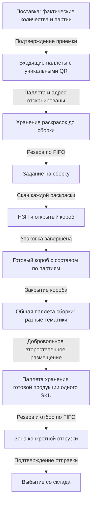

# Складские процессы и правила FIFO

Правила в этом документе — проектное предложение на основе требований. Спорные решения связаны с [открытыми вопросами](OPEN_QUESTIONS.md). Любой сценарий проверяется с реальными паллетами и устройствами.

## 1. Полный путь товара

Схема показывает физические переходы. Резервирование и создание заданий не считаются перемещением. Отгрузка списывает запас только после подтверждения отправки.

## 2. Первичная настройка склада

1. Создать склад и часовой пояс.
2. Нарисовать пилотную зону сверху: помещение, проходы, стеллажи, напольные места.
3. Для стеллажа создать секции, ярусы и конечные адреса.
4. Для каждого адреса задать полезные размеры, сторону доступа, форму хранения и профиль вместимости.
5. Создать адреса приёмки, рабочих станций, готовой сборки, отгрузки и карантина.
6. Проверить дубли адресов, пересечения, недостающие габариты и невозможные схемы укладки.
7. Опубликовать первую версию карты.
8. Сформировать PDF с QR и читаемыми адресами.
9. Наклеить этикетки, пройти маршрут с телефоном и отсканировать каждое выбранное место.
10. Подтвердить соответствие физических наклеек карте.

Приёмку на склад не запускать на непроверенных адресах. Для принудительного временного размещения использовать явный временный адрес, а не пустое поле местоположения.

## 3. Приёмка поставки

### 3.1. Создание документа

Руководитель в день приёмки указывает фактическую дату поступления и заполняет каждую физическую паллету: тематику, количество раскрасок, габариты и известную массу. Одна паллета — один SKU. Новую тематику можно создать прямо в форме. Документ сохраняется, даже если свободных адресов пока нет.

Создание документа не пополняет баланс: все его паллеты получают статус «Ожидает размещения», без адреса и резервирования места. Они не участвуют в FIFO, сборке и перемещениях. Приёмка видна в активном списке.

### 3.2. Маркировка

Для каждой физической паллеты система создаёт уникальный постоянный идентификатор и QR. Страница печати документа содержит по одной этикетке100×70 мм на паллету: номер, тема, исходное количество и дата поступления. Повторная печать сохраняет те же идентификаторы. Количество на стикере справочное: после расходования актуальный остаток виден в WMS.

QR паллеты не совпадает с товарным штрихкодом тематики. В локальной версии принимаются как QR-payload `artmate-wms:pallet:<id>`, так и читаемый номер паллеты. Адрес подтверждается аналогично своим QR или читаемым кодом.

### 3.3. Подтверждение размещения и баланс

1. Сотрудник на смене открывает паллету в активной приёмке.
2. Система показывает допустимые свободные места и рекомендацию по габаритам. Рекомендация не резервирует место.
3. Сотрудник клеит стикер, физически ставит паллету в ячейку, сканирует паллету и адрес.
4. Сервер в одной транзакции проверяет оба скана, сотрудника, принадлежность документу, габариты, массу и актуальную занятость/резервы адреса.
5. При успехе только эта паллета входит в баланс. В документе сохраняются исходное количество, адрес, сотрудник и время размещения. Дата FIFO остаётся датой фактического поступления.
6. При частичном размещении документ остаётся активным. Последняя паллета автоматически завершает приёмку и переносит её в архив. Архив открывается отдельной вкладкой на странице приёмки.

Неподходящий адрес или неверный скан не меняют остатки. Повтор той же подтверждённой команды возвращает прежний результат; новая попытка второй раз разместить уже принятую паллету отклоняется. Дальнейшие перемещения и расход не переписывают историю приёмки.

Общий баланс в штуках равен сырью + незавершённой сборке + готовым коробам на складе. Ожидающие размещения количества показываются отдельно. Уже оприходованный товар в пути между адресами остаётся на балансе, но недоступен для сборки до размещения. Пересчёты, расхождения и корректировка принятого документа относятся к следующим этапам.

## 4. Автоматический подбор места

В MVP используется понятный набор правил, без оптимизации всего склада.

### 4.1. Обязательные фильтры

- Адрес опубликован, активен, разрешён для нужной формы хранения.
- Адрес не заблокирован и не занят другой паллетой; активные резервы учтены.
- Ширина, глубина и высота подходят с учётом разрешённой ориентации и зазоров.
- Проверка массы пройдена, если она обязательна для адреса.
- Ярус доступен используемой технике и роли сотрудника.
- Размещение не перекрывает настроенный доступ к более старому запасу.
- При добавлении коробов на паллету совпадает SKU и соблюдается политика партий.
- Достаточно остаточной вместимости по количеству, высоте и массе.

### 4.2. Порядок среди допустимых мест

Рабочее предложение: предпочесть закреплённую зону тематики, затем подходящее место с меньшими затратами перемещения, затем устойчивый порядок по адресу. Объяснять выбор: «Подходит по высоте; зона раскрасок; место свободно».

Для сравнения расстояния на старте достаточно приоритета зон и расстояния по координатам. Это оценка, она не выдаётся за реальный маршрут через препятствия. Граф проходов и маршрутизация — отдельное развитие.

Если мест нет, вернуть причину: недостаточная высота, занятые места, нехватка вместимости, блокировка доступа. Предложить список допустимых действий: освободить место, переместить запас, использовать измеренный временный адрес. Неподходящий адрес автоматически не выбирается.

### 4.3. Подтверждение размещения

Сотрудник принимает задание, сканирует паллету, затем адрес. Сервер повторно проверяет актуальность места и габариты. Только успешное подтверждение меняет местоположение и превращает резерв вместимости в фактическую занятость.

Если физически выбрано другое место, система проверяет его теми же правилами. Допустимое изменение фиксируется с причиной; физически невозможное размещение не разрешается обходом обычной проверки.

## 5. Два контура FIFO

### 5.1. Раскраски до сборки

Владелец подтвердил FIFO по дате поступления на склад. Ключ старшинства: фактическая дата поступления → постоянный номер очереди учётной партии → ID партии. received_at хранит дату фактического поступления, а время подтверждения в системе хранится отдельно как время операции. Производственная дата справочная и не меняет очередь. Перепаковка и перемещение не обновляют дату поступления исходного товара.

Резервирование выбирает самую старую разрешённую партию с доступным количеством. Сначала используется её незарезервированный остаток, затем следующая. Внутри партии можно выбирать доступную паллету с меньшим остатком, чтобы быстрее освобождать места.

Заблокированный или карантинный товар не выдаётся в сборку. Физически недоступная старая партия требует действия: освобождение доступа, перемещение или зарегистрированное отклонение FIFO. Система не перескакивает к новой партии незаметно.

### 5.2. Готовые короба

Основа старшинства — даты поступления исходных партий в составе. Внутри одной партии более раннее завершение короба даёт мягкий приоритет. Если раньше собранный короб недоступен, можно взять доступный короб той же партии без обязательного перекладывания и отдельного разрешения на обход FIFO. Выбор сохраняется в обычной истории. Это рабочая реализация уточнения владельца «важно, но не слишком».

Для сценария из двух партий рабочая очередь: чистые короба старой партии → короба со смесью старой и новой → чистые короба новой партии. Для общего случая предлагается детерминированный ключ: самая старая партия в составе → самая новая партия в составе → время завершения → ID короба. Он соответствует этому простому сценарию, но не гарантирует строгий FIFO каждого экземпляра при произвольных смесях. До расширения на сложные смеси правило нужно проверить на реальных примерах.

Короба проверяются на физическую доступность. Если закрыт более ранний короб той же партии, допустим доступный короб этой партии. Если перекрыта старая партия, мягкий порядок внутри партии не позволяет незаметно выбрать новую: требуется освобождение доступа или зарегистрированное исключение.

### 5.3. Ограничение точности

Один закрытый короб нельзя частично отгрузить без операции разукомплектования. Смешанный короб связывает экземпляры разных партий. Поэтому FIFO с точностью до каждой раскраски невозможно гарантировать для любых составов закрытых коробов. Система сохраняет полный состав, применяет выбранный порядок контейнеров и показывает исключения.

## 6. Физическое хранение и доступ с четырёх сторон после спуска

Уточнение владельца: готовую паллету можно спустить и получить доступ со всех четырёх сторон. На карте различать адрес хранения и рабочий адрес отбора. Доступность короба оценивать с учётом возможного спуска; паллету на верхнем ярусе не считать навсегда недоступной.

Система должна поддерживать роли паллет:

- Накопление: принимаются новые готовые короба.
- Отбор: используются для отгрузки; новые короба не добавляются.
- Резерв: паллета завершена и ждёт очереди.
- Заблокирована: временно недоступна для обычных операций.

Роль отделена от физического адреса. На входящих паллетах и паллетах хранения — один SKU. В зоне сборки есть отдельная общая накопительная паллета: разные тематики хранятся на ней по уникально промаркированным коробам, пока не выполнено второстепенное размещение.

### Основной случай: одна партия на паллете

Предпочитать раздельное хранение партий одной тематики, когда старой партии достаточно и есть подходящая вместимость. Абсолютная очередность каждого короба внутри партии не обязательна: отбирать доступные короба с мягким предпочтением более ранних.

### Допустимое дополнение новой партией

Владелец разрешил совместное хранение партий одной тематики при нехватке старой партии. Система сохраняет партии каждого короба; смешанный короб хранит количественный состав. Дополнение не превращает весь запас паллеты в одну новую или старую партию.

Условие нехватки для автоматического решения о смешении целой паллеты уточняется в Q-35. До этого реализация должна поддерживать явное основание смешения и не считать любые разные партии свободно совместимыми. Для короба уже определён пример: 10 старых + 10 новых до полной упаковки 20.

Размещение новой партии не должно перекрывать отбор старой. Проверять доступ после спуска паллеты с четырёх сторон. Для MVP использовать измеренные схемы укладки и роли паллет без трёхмерной модели каждого короба.

### Проверка перед выбором

На одной тематике физически собрать паллету, спустить её в рабочую зону с доступом со всех четырёх сторон, выполнить несколько циклов накопления и отгрузки и посчитать лишние перекладывания. Если требуется переставлять короба только ради времени сборки внутри одной партии, применять мягкий приоритет и выбирать доступные. Перекрытие коробов более старой партии остаётся проблемой размещения. Масштабировать карту только после этого эксперимента.

### Спуск, отбор и возврат паллеты

1. Зарезервировать место в зоне отбора с доступом со всех четырёх сторон.
2. Создать задание на спуск конкретной паллеты; проверить доступ исполнителя к нужной технике.
3. Просканировать паллету и рабочий адрес, подтвердить фактическое перемещение.
4. Отбирать назначенные короба, сохраняя FIFO и блокируя конфликтующие операции с этой паллетой.
5. После отбора проверить остаток и либо вернуть паллету на сохранённый адрес, либо подобрать новый допустимый адрес.
6. Исходное место при необходимости удерживать отдельным резервом возврата. Нельзя считать, что оно одновременно свободно для поступления и гарантировано для возврата.

Спуск даёт доступ с боков, но не устраняет нагрузку верхних коробов на нижние. В пилоте проверить укладку по доступным колоннам/слоям и фактическую стоимость отбора. Учёт четырёх сторон не требует 3D-редактора в первой версии.

## 7. Ручное задание на сборку

Форма MVP: тематика → вариант упаковки → число коробов → приоритет → создать. Количество раскрасок считается автоматически. Дополнительные сложные настройки скрываются за справочником упаковки.

Задание создаётся в очереди. До начала можно планировать потребность без захвата всего запаса. При назначении сотруднику сервер атомарно резервирует достаточный объём по FIFO и вместимость для ближайшей выпускаемой порции. Момент резерва уточняется на пилоте; единое правило должно быть одинаковым во всех источниках задания.

Если товара недостаточно, не молча уменьшать задание: явно предложить доступный объём или оставить ожидать пополнения. Порционное исполнение разрешается с видимым остатком задания.

Пример: 10 коробов × 20 = 200 раскрасок. Есть 150 в старой партии и 100 в новой. Резерв: 150 старой + 50 новой. Расход идёт последовательно из старой партии; состав каждого короба фиксируется фактически.

Повторный клик создания не должен порождать второе задание. Для намеренного создания ещё одного задания нужен новый запрос.

## 8. Смена и принятие задания

В текущей управленческой версии руководитель создаёт задание с необязательным исполнителем. После создания назначение можно изменить в карточке, а сотрудник на смене может самостоятельно взять свободное задание. На административном экране выбранный «Работаем как» исполнитель — демонстрационный контекст, не личная авторизация; мобильный экран будет отдельным этапом.

Сервер атомарно закрепляет задание за сотрудником и начинает работу. У одного сотрудника может быть только одно активное задание, чужое назначение нельзя забрать. Смена вне работы/перерыв приостанавливает его активное задание, сохраняя текущий короб. Возобновление доступно тому же исполнителю на смене.

Переназначение разрешено в очереди или после паузы, между коробами (нет отсканированных единиц и подтверждённой этикетки открытого короба). Незавершённый короб сначала нужно закончить; передача НЗП другому человеку относится к следующему этапу. Снятие исполнителя возвращает задание в свободную очередь, резервы товара сохраняются.

## 9. Сборка короба: протокол сканирования

### 9.1. Начало

Для каждого короба сотрудник подтверждает исходную паллету по FIFO. Физически готовит товар — для стандартного короба20 штук это2 упаковки по10, упаковывает и маркирует раскраски. Пачки отдельно на балансе не учитываются; списание идёт по единицам при сканировании.

Затем открывает печатную страницу уникального короба, печатает этикетку, клеит на короб и сканирует её. Печать и перепечать не создают запас и не изменяют код. До подтверждения этикетки сканы раскрасок запрещены. На экране видны ожидаемый источник, код короба и счётчик0 из20.

### 9.2. Каждый экземпляр

Товарный штрихкод должен совпадать с SKU задания. После принятого сканирования сотрудник кладёт экземпляр в открытый короб. Сервер переводит одну единицу из исходной паллеты в НЗП этого короба, уменьшает соответствующий резерв и записывает исходную партию.

Счётчик подтверждается сервером. Нельзя принять 21-ю единицу в короб на 20. При неверном коде: заметная ошибка, количество не изменяется. При недоступном источнике или исчерпанном резерве: остановка, затем разрешение причины.

Одинаковые коды SKU подряд являются нормой. Нельзя запрещать повтор одного и того же значения штрихкода по таймеру: так потеряются реальные экземпляры. Сетевой повтор одного события с тем же ID исключается отдельно. Два физических чтения одного экземпляра с разными ID система сама распознать не может; нужны дисциплина, проверка счётчика и операция исправления.

### 9.3. Смена партии и смешанный короб

Если в старой паллете осталось 10, а короб вмещает 20:

1. Принять 10 сканирований старой паллеты.
2. Показать 10 из 20 и следующий назначенный источник.
3. Потребовать сканировать новую паллету.
4. Принять ещё 10 сканирований того же SKU из новой партии.
5. Сохранить состав 10 + 10, не присваивая всему коробу одну условную партию.

Истощённая паллета освобождает адрес только после подтверждения её фактического удаления или завершения цикла использования. Нулевой товарный остаток ещё не доказывает, что поддон убран с места.

### 9.4. Закрытие и следующий цикл

Последний принятый скан автоматически закрывает полный короб в одной SQL-транзакции: сохраняются количественный состав по партиям и профиль упаковки, создаётся уникальный готовый короб, пополняется общая накопительная паллета в месте типа «Сборка», увеличивается результат сотрудника. На обычном пути отдельная кнопка упаковки не нужна. Восстановление полного незавершённого короба прежней версии остаётся отдельным явным действием.

Место сборки должно быть активно и вмещать общий накопитель с коробами разных тематик. Размеры рассчитываются консервативно из физического поддона и сохранённых габаритов коробов. Автоматически отправлять готовый короб на случайный стеллаж или напольный адрес нельзя. Если подходящего места сборки нет, последний скан откатывается полностью, предыдущиеN−1 единиц остаются в НЗП, количество источника не теряется. После освобождения/создания места скан можно повторить.

Закрытие не списывает ранее принятые единицы второй раз: общий баланс сохраняется сырьё→НЗП→готовые короба. Каждая команда привязана к исполнителю задания на смене. Сетевой повтор последнего скана с тем же requestId возвращает прежний результат, не закрывает второй короб и не сканирует товар в следующем задании.

Если в задании остались короба, начинается следующий цикл с новой этикеткой и повторным сканом исходной паллеты. Если задание завершено, система атомарно берёт следующее доступное ожидающее задание этому сотруднику: сначала заранее назначенное ему, затем свободное по времени создания. Чужие и приостановленные не берутся; недоступные источники пропускаются с сохранением готового результата. Если очереди нет, сотрудник видит завершение и может выбрать новое задание позже.

## 10. НЗП, отмена и исправления

| Ситуация | Действие |
|---|---|
| Ошибочное последнее сканирование | Сотрудник оформляет разрешённую отмену с физическим изъятием экземпляра; создаётся обратное движение |
| Пауза в середине короба | Сохранить количество, партии, исполнителя и адрес НЗП; свободный остаток не увеличивается |
| Отмена задания до расхода | Освободить товарные резервы и резервы места |
| Отмена после части сборки | Готовые короба остаются готовыми; НЗП требует завершения или документированного возврата |
| Возврат из НЗП | Вернуть по известным партиям на совместимую паллету/адрес; смешанные неразличимые экземпляры не разделять выдуманно |
| Брак | Отдельное движение в карантин или списание с причиной и правом доступа |
| Повреждённый короб | Заблокировать отгрузку; перепаковка сохраняет состав и историю |
| Потерянная этикетка | Повторно напечатать тот же QR после идентификации; не создавать новый остаток |
| Передача другому сотруднику | Передать задание и НЗП явно; сохранить вклад по событиям каждого исполнителя |
| Браузер закрыт/телефон заменён | Восстановить серверное состояние активной смены, коробов и последнего принятого события |

Если физически смешанные партии уже неразличимы, возврат или разукомплектование требует отдельного учётного решения руководителя. Нельзя автоматически утверждать, что конкретный экземпляр вернулся в старую партию.

## 11. Второстепенное размещение готовых коробов

После закрытия короба он остаётся на общей паллете зоны сборки; в той же транзакции создаётся свободное второстепенное задание на этот короб. Тематики в накопителе могут быть разными, но внутри каждого короба сохраняются его SKU и партии. На паллетах хранения тематики не смешиваются.

1. Сотрудник по желанию открывает «Размещение коробов» и берёт задание. Основную сборку перед этим нужно завершить или поставить на паузу. Сервер резервирует подходящий адрес: прежде совместимую паллету той же тематики, затем свободный адрес хранения. Входящие резервы учитывают оставшуюся вместимость.
2. Сканирует короб и исходный адрес сборки, подтверждает забор. Количество на накопителе уменьшается, короб получает статус «В пути». Пустой общий поддон физически остаётся на месте и продолжает принимать новые короба.
3. Сканирует тот же короб и зарезервированный адрес хранения. Сервер добавляет короб на совместимую тематическую паллету либо создаёт её на свободном месте. Задание завершается; повтор того же запроса не создаёт второй короб.
4. Следующее второстепенное задание сотрудник берёт сам. Автоматическая выдача следующих основных заданий не запускает добровольное размещение.

До забора задание можно освободить в очередь вместе с резервом места. После забора сначала нужно поставить короб: бросить задание или закончить смену с коробом в пути нельзя. Неверный скан, занятый/неподходящий адрес или чужой исполнитель не меняют запас, ввод остаётся для исправления.

В пути короб остаётся на общем балансе, сохраняет состав партий, профиль упаковки и QR. В отгрузку допускаются только размещённые короба. Общую смешанную паллету нельзя целиком перевезти на адрес тематического хранения вместо разбора коробов. Паллетные перемещения и спуск обычных готовых паллет работают после размещения.

Текущий срез — один короб на задание. Групповой перенос россыпи коробов и специальный возврат уже взятого короба относятся к дальнейшему развитию; контейнер не теряется из учёта, а сотрудник завершает подтверждённое размещение.

## 12. Простая отгрузка

### Создание

Руководитель вводит получателя/назначение и потребность: SKU, число коробов, вариант упаковки. Доступный остаток учитывает уже зарезервированные короба, карантин и незавершённые перемещения.

Количество отгрузки независимо от задания сборки. Например, собрано 10 коробов: первая отгрузка требует 3, резервируется только 3, остальные 7 остаются свободным готовым запасом. Следующая отгрузка может забрать ещё 2; после отправки остаётся 5. Один результат сборки может расходоваться несколькими отгрузками, а одна отгрузка — объединять готовые короба разных заданий.

Из паллеты можно отобрать только нужную часть коробов. Остаток не списывается, сохраняет партии и QR и возвращается в место хранения. Упаковка по 20 не требует отгружать все 20 собранных коробов или всю паллету; размер упаковки относится к содержимому одного короба.

### Резерв

Система выбирает конкретные уникальные короба по FIFO. При недостатке показывает недостающий объём. Старые короба, которые недоступны физически, создают проблему на разрешение; выбор новых с обходом фиксируется отдельно.

### Отбор

При необходимости сначала выполняется спуск паллеты по процессу раздела 6. Сотрудник видит актуальный рабочий адрес, паллету и список коробов. Сканирует назначенные короба и адрес консолидации конкретной отгрузки. На мобильном экране допустим выбор доступных коробов одной партии при атомарной замене резерва; мягкий приоритет времени сборки не требует отдельного разрешения. Любая другая замена требует проверки политики и причины.

### Отправка

Проверить комплектность. Подтвердить фактическую отправку. Одной транзакцией изменить статусы коробов, погасить резервы, создать выбытие и закрыть отгрузку. Повторное подтверждение возвращает прежний результат.

Отмена до отправки освобождает резервы, но физически собранные короба сначала возвращаются из зоны отгрузки отдельным перемещением. После отправки используется процесс возврата, а не отмена исторического документа.

Возврат с известным QR сохраняет происхождение, проходит осмотр/карантин и только затем возвращается в доступный запас. Неидентифицируемый возврат получает признак неизвестного происхождения.

## 13. Инвентаризация

Пересчёт по адресу или паллете. На короткое окно блокируются конфликтующие движения по этому объекту; операции других адресов продолжаются. Снимок, фактический пересчёт и подтверждение расхождения разделены.

Для раскрасок — количество по паллете и известной партии. Для готовых коробов — сканирование уникальных коробов, проверка вложенности в паллету и фактического адреса. Проверка содержимого закрытого короба — отдельное вскрытие, а не предположение по наличию этикетки.

Расхождения подтверждает уполномоченный сотрудник с причиной. Изменение создаёт отдельную корректировку и сохраняет первоначальный снимок. Потерянный короб нельзя одновременно оставить в резерве отгрузки.

## 14. Работа при потере сети

Первая версия требует связи для подтверждения операций. Экран явно показывает неподтверждённую команду. Клиент хранит её ID и повторяет тот же запрос после восстановления; ответ сервера восстанавливает состояние без повторного списания.

Не выдавать звук успеха до принятия сервером. При потере связи остановить дальнейшие сканирования, показать последний подтверждённый счётчик и инструкцию сохранить текущий физический короб. Это ограниченный повтор одной команды, а не обещание автономной складской работы.

Если сотрудник физически положил экземпляр, но ответ потерян, сначала запросить состояние события/короба по ID. Нельзя автоматически просить положить ещё один экземпляр. Неустранимое расхождение переводится в проверку НЗП.

## 15. Перспектива прогнозирования

Сейчас человек создаёт задание вручную. Позже внешний модуль собирает данные маркетплейсов и формирует предложение «собрать N коробов SKU X». Руководитель первоначально утверждает предложение, после чего тот же сервис создаёт обычное задание.

Прогноз учитывает как минимум готовый свободный запас, уже созданные задания, НЗП, резервы отгрузок, ожидаемые поступления и вместимость. Смысл внешнего остатка и товара в пути нужно определить отдельно, чтобы не вычесть один и тот же запас дважды.

Переход к автоматической публикации заданий выполняется только после проверки качества предложений, ограничений мощности и защиты от повторной генерации. Источник задания не меняет протокол сканирования и правила складского учёта.
