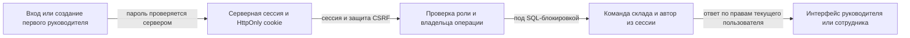

# Вход, сессии и права

Источник API — Nest DTO → Swagger → Orval. Учетные записи и сессии в отдельных SQL-таблицах, без секретов в WorkspaceDto, журнале товара или ответах идемпотентных складских команд. Существующие сотрудники, товары, карта, журнал и ревизия сохраняются при миграции.

Первый запуск предлагает создание руководителя со своим паролем, без общих стандартных данных входа. Руководитель создает доступ для существующего сотрудника, выбирает роль, блокирует/возвращает доступ, сбрасывает временный пароль и отзывает сессии. Последний активный руководитель защищён от блокировки/понижения. Временный пароль требует смены владельцем до доступа к складу.

Как читать: скрытые кнопки помогают пользователю, но фактическое разрешение проверяется сервером; перепроверка выполняется перед повтором команды и изменением остатков.

Руководителю доступны управление и назначение. Рабочие подтверждения выполняются от текущего сотрудника, без подмены исполнителя. Сотрудник видит свою смену, свои и свободные задания, исполняет размещение приёмки, сборку, размещение коробов и перемещения; схема только для просмотра. Управленческие разделы закрыты, ответ Workspace для сотрудника ограничен.

При смене личности/роли или потере доступа очищаются запросы и повторяемые команды предыдущего пользователя. Ответы старой сессии, пришедшие позже, отбрасываются. CSRF и пароль не сохраняются в браузерных хранилищах. Ошибки форм сохраняют ввод; вход допускает автозаполнение и вставку пароля. Аккаунты и исторические сотрудники не удаляются.

## Правила взаимодействия
- `rule/name-object-scope-consequence`: блокировка, роль и отзыв сессий сообщают объект и последствия до применения.
- `rule/auth-allows-assistance`: password manager, autocomplete и вставка разрешены.
- `rule/cover-reachable-states`, `rule/error-states-recovery`, `rule/preserve-user-input`: предусмотрены первый запуск, вход, обязательная смена пароля, отсутствие доступа, истёкшая/отозванная сессия, сетевые ошибки и повтор.
- `rule/control-matches-cardinality`: две роли показаны одновременно.

## Источники безопасности
Проверены официальные рекомендации [OWASP Session Management](https://cheatsheetseries.owasp.org/cheatsheets/Session_Management_Cheat_Sheet.html), [OWASP Password Storage](https://cheatsheetseries.owasp.org/cheatsheets/Password_Storage_Cheat_Sheet.html) и [Node crypto](https://nodejs.org/api/crypto.html). Сетевой запуск вне локального компьютера потребует отдельного HTTPS-развёртывания; текущие сервисы привязаны к loopback.
