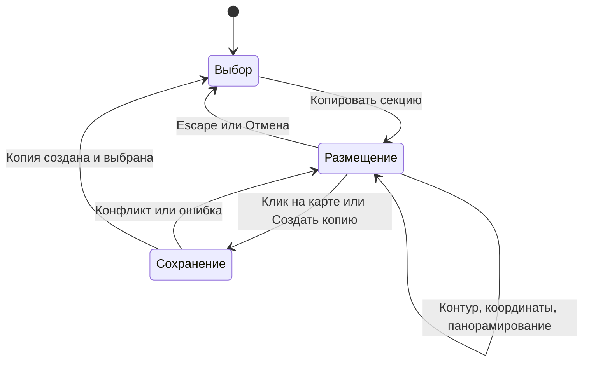

# Контракт

Кнопка «Копировать секцию» в карточке конструктора включает выбор положения. На карте появляется предварительный контур; короткий клик создаёт копию, движение мыши обновляет положение. «Рука» сохраняет панорамирование, обычное перетаскивание в режиме копирования не создаёт объект. Точная форма X/Y с кнопкой создания даёт альтернативу карте. Escape и «Отмена копирования» завершают режим. Ошибка сохраняет положение и режим для исправления. До подтверждения навигация и предварительный просмотр не пишут данные.

Как читать: копия существует в базе только после успешного сохранения. Ошибка оставляет режим размещения, отмена возвращает обычную карту.

Серверная команда `copyRackSection(id,{requestId,x,y})` под общей транзакцией копирует размеры, поворот и физические ограничения всех активных ярусов, включая ручной признак закрытого адреса. Архивные ярусы не восстанавливаются. У копии новые ID, QR, коды и названия; она создаётся с пустыми адресами. Исходные товары, резервы и ссылки сохраняются. Коллизии, выход за склад и некорректный источник отклоняют всю команду. Полный контракт — ADR 034.

Для мест клиент предлагает первый свободный P-01 / «Место 1» с учётом всех секций и адресов, включая архивные. Имена можно редактировать и генерировать заново. Переключение типа и фоновые обновления не стирают ввод. Финальную уникальность проверяет существующий API.

Backend, ядро карты и автозаполнение мест выполняют отдельные агенты. Root интегрирует команды, выбор источника и результат, документацию и проверки. Сохраняются FSD, Nest/Swagger → Orval и версия схемы 7. Новых зависимостей нет.
