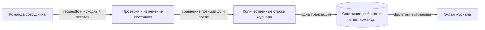

# Журнал учёта и корректировки

Отдельный неизменяемый журнал в PostgreSQL хранит подписанные количественные строки по SKU, партии, стадии, контейнеру и адресу. История читается страницами, а не входит в регулярно обновляемый WorkspaceDto. Изменения состояния, событие и ответ повторяемой команды фиксируются одной транзакцией. Метки сущностей сохраняются на момент операции.

Как читать: состояние и журнал изменяются вместе; повтор запроса возвращает сохранённый ответ без нового списания. Внутренние операции дают нулевое изменение общего баланса.

При подключении фиксируется начальный остаток, история до этого момента не восстанавливается по догадкам. Пересчёт меняет количество сырья в существующей партии. Списание сохраняет идентичность и состав конкретного короба. Проверяются резервы, перемещения, актуальность адреса/количества и работающий сотрудник. Причина обязательна. Перед отправкой показываются исходное и итоговое количество и эффект на баланс. Серверная ошибка сохраняет введённые данные. Исправление оформляется следующей операцией, прежнее событие не редактируется.

Произвольный приход готовых коробов без подтверждённого состава партий и правка незавершённой сборки не входят в этот этап.
