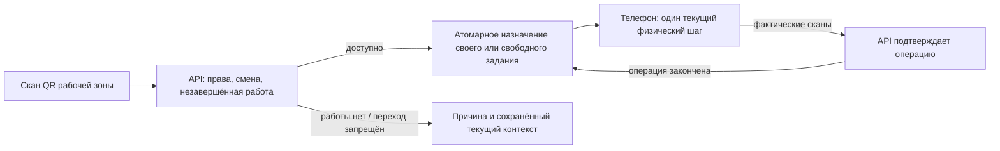

# Решения

Логические warehouse.workZones привязываются к существующим locationIds. Новых паллетомест, вместимости или второй геометрии нет. Несколько зон/QR могут использовать один физический адрес. Receiving — приёмочные площадки; assembly и putaway разделяют текущий смешанный накопитель; shipping — готовые зарезервированные короба на picking/shipping адресах.

Назначения warehouse.zoneWork серверные, actor из сессии. POST startZoneWork принимает настоящий QR, атомарно выбирает своё/свободное доступное задание, резервирует исполнителя и сохраняет контекст зоны. Повтор QR возобновляет; чужой carry/WIP/dirty блокирует переключение с сохранением ввода. После закрытия операции сервер продолжает очередь той же зоны. Без задач — причина и возможность сканировать другую зону. leaveZoneWork освобождает только безопасную незавершённую привязку; факты работы не удаляются.

Для отгрузки отдельное назначение, сканы точного набора reserved boxes и явное финальное действие с количеством. QR/сканы не списывают остатки. Менеджер планирует FIFO и предварительные перемещения; сотрудник завершает только своё подготовленное исполнение.

Shared scanner gateway распознаёт QR зоны до помещения в очередь бизнес-сканов. Widget решает маршрутизацию; shared не содержит warehouse logic. Существующие EmployeeScan serial/replay/auth-epoch guards сохраняются. Все изменения API из DTO/Swagger, web через Orval.

Как читать: QR выбирает работу; товар учитывается только последующими физическими подтверждениями API. Назначение и продолжение очереди согласуются под SQL lock, а не эффектом браузера.

Правила product-design: rule/smallest-intervention, rule/one-primary-action, rule/preserve-user-input, rule/cover-reachable-states, rule/name-object-scope-consequence.
