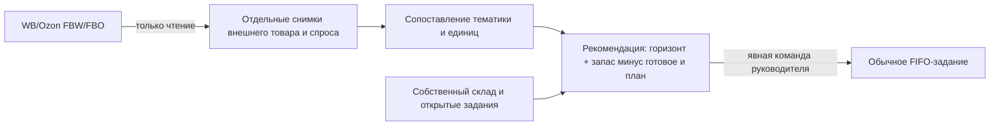

# Граница интеграций и планирования

Внешние остатки отдельны от собственных количественных позиций. Импорт и расчёт не меняют balance, не создают приёмок/отгрузок и не объявляют физические операции выполненными. Руководитель явно создаёт обычное queued-задание из актуального предложения с проверкой текущего сырья/FIFO и защитой дублей.

Две управленческие страницы: /integrations — ключи, обновление, сопоставление и количество раскрасок в внешнем товаре; /planning — период, горизонт, запас, путь и объяснение потребности. Сотрудник сохраняет простой /work без новой конфигурации.

Схема показывает, что только последняя команда создаёт работу; импорт не становится складским приходом.

Неизвестные/частичные/просроченные сведения обозначаются явно. Поставки в пути, не подтверждаемые API, требуют отдельного ручного подтверждения количества, включая явный ноль. Готовые короба на общем накопителе учитываются для новой сборки, но не считаются готовыми к немедленной отгрузке. Остаток задания уже включает начатый короб: НЗП не добавляется повторно.

Секреты: шифрование на сервере, ключ отдельно от БД, lazy creation0600; ничего в WorkspaceDto/browser storage/commands response/log. Sync сеть вне глобальной SQL-блокировки; публикация атомарна после свежих прав/версии подключения.

Product-design: rule/name-object-scope-consequence — явная команда создания задания; rule/cover-reachable-states — empty/loading/error/partial/stale/missing mapping; rule/preserve-user-input — RHF и контекст при ошибке; rule/one-primary-action — подключить/обновить и создать задание в соответствующем состоянии.
