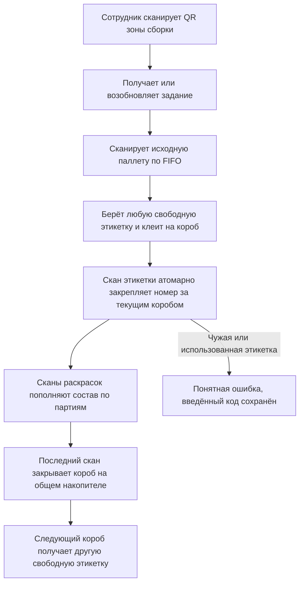

# Сценарий

## Печать

Руководитель вводит число 1–1000 и создаёт запас. Создаются только идентификаторы и QR, без товаров, резерва или готовых коробов. В универсальной этикетке нет тематики или количества: они появятся в учёте после сборки. Предварительный печатный комплект ограничен 100 свободными этикетками; повторная печать сохраняет номера. Отмена системного диалога не считается фактом печати.

Объект и последствия создания явно названы, есть проверка количества; отдельный modal подтверждения не нужен (product-design: rule/name-object-scope-consequence, rule/smallest-intervention). Сервер хранит requestId для повторной отправки после потерянного ответа. Роль руководителя и auth epoch проверяются до replay.

## Сборка

Стрелки — подтверждённые сервером действия. Пустая этикетка сама не меняет остаток. Номер после закрепления никогда не возвращается в свободный запас, даже после отгрузки или списания. Старые коды автоматически созданных коробов продолжают работать.

Состояния: нет запаса → руководитель создаёт; загрузка/ошибка/retry; свободная; закреплена за открытым коробом; закрытый/отгруженный/списанный короб остаётся тем же номером. Повтор скана в текущем коробе безопасен; другой короб/исполнитель отклоняется. Пауза/возобновление сохраняет связь. Сетевой отказ не переводит интерфейс к следующему шагу без ответа API. Worker видит одно сканирование с краткой подсказкой, отдельного выбора режима нет (rule/cover-reachable-states, rule/preserve-user-input, rule/error-states-recovery, rule/smallest-intervention).

## Телефон

HTTPS gateway 3443 слушает частную сеть, HTTP-инструкция 3442 отдаёт только публичный сертификат CA и помощь. Основной web/API остаются на loopback 3080/4080; новый gateway проксирует только к ним. Точные HTTPS origins передаются API штатным start; cookie на TLS-границе получает Secure. Не открываются БД, публичный tunnel или внешний домен.

CA/сертификаты хранятся в `.data/phone-access` и исключены из Git. ОС телефона должна доверять локальной CA; физическую установку выполняет пользователь. Сертификат не несёт паролей WMS. Вход сотрудников — прежние личные аккаунты.
