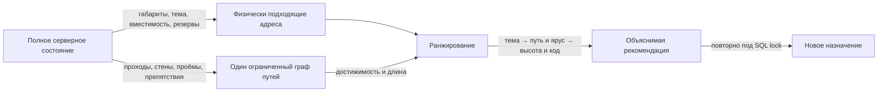

# Подход

Как читать: физическая совместимость остаётся первым фильтром. Расчёт пути влияет на новое назначение; текущие claimed/in_transit адреса сохраняются.

Паллеты своей тематики ранжируются раньше пустых мест. Внутри группы подтверждённый путь лучше неизвестного. Стоимость = длина пути + 12 условных метров за каждый ярус выше первого; это мягкий вес обработки, не физическое расстояние. Затем используется минимальная подходящая высота и код.

Граф учитывает реальные проходы, препятствия, повороты и проёмы между помещениями. Без нанесённых проходов внутри помещения допускается оценка по свободному полу с явной пометкой. Локальный подход от места к проходу ограничен 2 метрами и не соединяет разорванные сети. Неизвестный источник, неполный подход или лимит вычислений дают unknown; подтверждённо разорванная сеть — unreachable без автоматического предложения. По прямой через стену путь не подменяется. Ручное физически корректное размещение остаётся доступно.

Начальная точка приёмки определяется только однозначно; для коробов это fromLocationId. Источник и расстояние не являются GPS сотрудника. Сторона доступа не моделируется, поэтому расстояние до края места является оценкой.

DTO рекомендации добавляется к GET placement-options, Swagger → Orval. Вычисления не меняют склад, cached commands и баланс; схема БД не изменяется.
