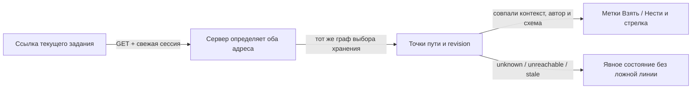

# Подход

Один серверный маршрутизатор обслуживает ранжирование и карту. Для карты восстанавливаются реальные ортогональные отрезки выбранного пути через предшественников Dijkstra, включая короткие подходы и проёмы. Нельзя соединить точки диагональю через стеллаж или стену. Неизвестный/разорванный маршрут не заменяется прямой линией.

GET work-route принимает ссылку на рабочий документ; исходный/целевой адреса вычисляются сервером из актуального полного state и прав. Для сборки путь идёт от FIFO-паллеты к общей сборке, для приёмки — от однозначной площадки приёмки к текущей рекомендации, для размещения — от общего накопителя к назначенному хранению, для перемещения — между его адресами, для отгрузки — от следующего короба к однозначному адресу своей отгрузочной зоны.

Как читать: документ задаёт адреса, сервер возвращает геометрию пути, клиент только отображает её. Местоположение человека не отслеживается.

Карточка остаётся компактной. По умолчанию виден весь путь и оба конца; доступен весь склад. Форма сканирования остаётся смонтированной. Закрытие возвращает ввод; смена операции/авторизации закрывает старую карту, поздний ответ не рисуется. Изменение геометрии меняет канонический SHA-256 layoutKey и убирает устаревший путь. Обычные сканы других сотрудников меняют revision, но не прерывают показ неизменившейся схемы. Пока карта открыта, read-only маршрут обновляется каждые 5 секунд. Адрес текущего шага сверяется с соответствующим концом ответа, чтобы новый подбор не противоречил экрану сканирования. API/клиент — Swagger → Orval, геометрия не дублируется на web, схема БД и команды учёта не меняются.
