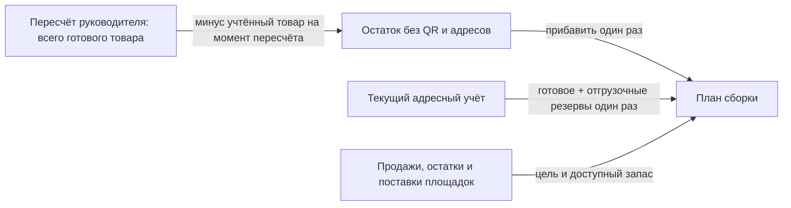

# Модель готового остатка

Подтверждение хранится отдельно от адресного учёта. На момент пересчёта фиксируются весь заявленный готовый товар и уже учтённый готовый товар. Неоформленный остаток равен разнице. Впоследствии план складывает эту разницу с текущим учтённым товаром; новые сборки и штатные списания меняют расчёт без повторного прибавления исходных коробов.

Как читать: пересчёт уточняет общий запас для прогноза; физические короба и доступность отгрузки появляются только по обычным складским операциям.

Приблизительное количество не разрешает создание задания. Пересчёт старше семи дней и новые внешние поставки требуют проверки неразмеченного остатка. Отправки/списания старых неразмеченных коробов вне WMS требуют повторного пересчёта. Последующая регистрация таких коробов должна переносить их из неразмеченного пула, а не создавать дополнительный товар.

Снятие с продажи исключает только планирование; каталог и физический учёт сохраняются. API остаётся Nest DTO → Swagger → Orval. В интерфейсе уточнение доступно в подробностях товара.
