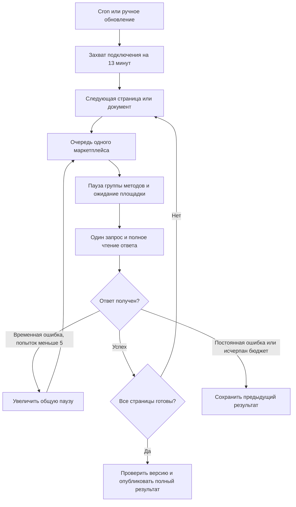

# Подход

Общая последовательная очередь сетевых попыток на маркетплейс с интервалами по группам методов. Паузы по заголовкам сервера и ограниченные повторы одного запроса при временной ошибке. Успешные страницы текущего запуска не скачиваются заново из-за повтора следующей страницы. Бюджет запуска и lease согласованы; публикация по-прежнему только целиком, складские данные не меняются. Постоянное хранение сырых ответов не вводится.

Как читать: сеть работает вне SQL-транзакции. Повтор возвращается к текущей странице; уже обработанные страницы текущего запуска остаются в памяти. Общий бюджет включает все паузы и чтение ответа. Публикация выполняется атомарно только после полной загрузки.
