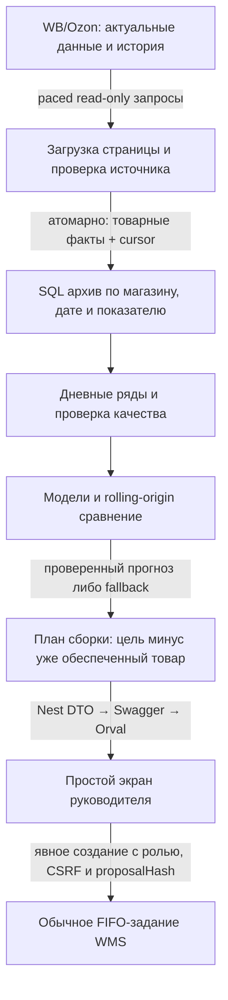

# Архитектура

## Границы
`marketplaces` владеет подключением, текущим импортом и складским предложением. `forecasting` владеет постоянным архивом, продолжениями истории и чистым движком прогноза. Сеть вне SQL lock. История не входит в WorkspaceDto и не меняет физический учёт.

Как читать: история сохраняется отдельно от текущих остатков. Модель выбирается по проверке на прошлом, не по сложности. Весь складской учёт и правила создания задания остаются в существующем серверном сценарии.

## Внутренний контракт движка
Дневная точка: date YYYY-MM-DD, units number|null, availability available|out_of_stock|unknown. Серия имеет устойчивые store/provider/externalId/metric; SKU-проекция выполняется по подтверждённым mappings. Движок получает series, asOf и horizonDays; возвращает daily forecast, totalUnits, selectedModel, confidence, candidates с MAE/WAPE/bias/числом окон и причина fallback. Поля внутреннего контракта не копируются вручную на web: внешний DTO отдельно генерируется.

## Неизменные правила
Неизвестные дни и остатки не равны нулю; financial sold не равно operational ordered−cancelled. Архив не создаёт складские движения, задачи и начисления. Новые ключи/категории доступа требуют явного подтверждения. Никаких несанкционированных внешних ML-сервисов: обучение локальное. Пользовательские API-ключи и сырые upstream payload не сохраняются в артефактах/логах/ошибках.
