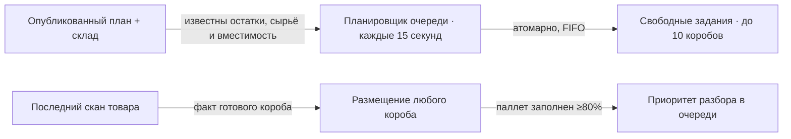

# Устройство автоматических заданий

Планировщик использует только актуальный опубликованный прогноз. Он не создаёт складские остатки, отгрузки или факты выработки. Одна неначатая автоматическая задача на SKU; изменение потребности пересчитывает её с сохранением ID либо снимает с архивом причины. Назначенные и начатые задачи не меняются.

Короб занимает будущий слот после подтверждения его кода. Под SQL lock учитываются физические короба и все открытые короба сотрудников. Уже открытый короб можно закончить; при полном накопителе нельзя начать следующий. QR другой зоны остаётся доступен.

Ручные задания сохраняются. Сборка впрок выдаётся по одному коробу, только при подтверждённой физической вместимости хранения. Неизвестные адреса готовых остатков нельзя считать пустым складом.
