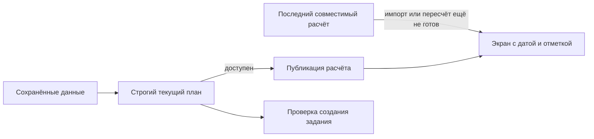

# Сохранённый расчёт

В existing forecast_results хранится отдельная sanitized проекция последнего доступного плана. Совместимость зависит от аккаунтов/версий подключений, mapping, SKU/упаковки, настроек и политик, но не от времени, import status или revision истории. GET под manager auth возвращает текущий строгий plan и отдельный previousPlan только при необходимости. Нельзя создать задачу по previousPlan: флаги выключены, сервер команды пересчитывает строгий план.

При первом запуске новой версии можно восстановить предварительный расчёт из полных сохранённых snapshots, явно указав давность источников. Это не точный ранее опубликованный результат. Missing quantities остаются missing; при смене подключения старые snapshots не допускаются. Сохраняются исходные даты расчёта и отправок. Не меняются склад, FIFO, ключи, mappings и auth.

Чтение схемы: экран может показывать предыдущий результат. Команда всегда проходит отдельную проверку по текущим данным.
