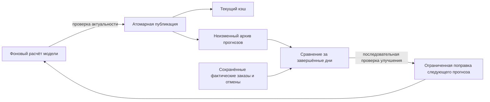

# Решение

Кэш остаётся быстрым текущим расчётом. Архив — отдельная append-only таблица, запись в той же транзакции успешной публикации. Храним будущие дневные количества, исходный прогноз, применённую поправку, дату публикации и идентичность магазина/товара/упаковки/модели. Исторические факты не дублируем в каждом получасовом расчёте.

Как читать: опубликованный прогноз не переписывается. Факт для сравнения читается отдельно и может уточняться импортом. Поправка допускается лишь после накопления реальных последующих продаж и проверки вне обучающего отрезка.

Дни до публикации и день публикации не оцениваются как прогноз будущего; будущие дни ожидают факта, неизвестные не становятся нулями, дни отсутствия товара исключаются из оценки скрытого спроса. Финансовые выкупы и возвраты не суммируются с операционными заказами. Старые прогнозы не реконструируются задним числом.
