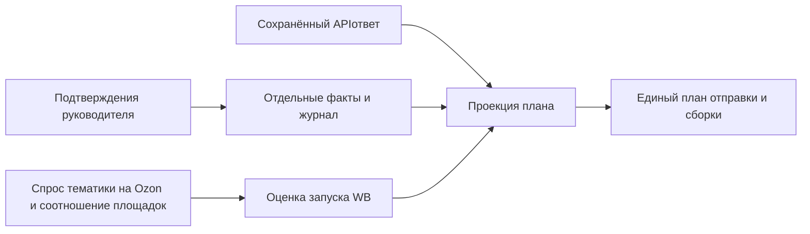

# Решение

Manager-факты хранятся отдельно от импортированных snapshots: исключение конкретной утраченной поставки, временное подтверждение нулевого остатка, явная политика запуска по другой площадке. Каждый факт имеет причину, автора, время, trustedstore/version и обратимое отключение; события append-only. Положительный API остаток имеет приоритет и окончательно отменяет ручной ноль. Нулевое подтверждение истекает через7дней, не меняет продажи и наличие для обучения.

Прогноз запуска переносит кривую той же тематики с Ozon на WB, умножая на устойчивую медиану отношений спроса площадок по минимум3сопоставимым товарам. Сравниваются одинаковые известные даты после появления, исключаются явно stockoutдни. Историческое неизвестное наличие не превращается в нули; известные нулевые заказы из полного покрытия сохраняются. Новогодний рост берётся из кривой донора один раз. Это предварительный сценарий, не годовая MLмодель; при достаточной собственной истории включается обычный прогноз. Нет подходящих сравнений — спрос остаётся неизвестным.

Схема показывает отдельность исходного APIответа, ручных фактов и прогнозной оценки. Импорт/прогноз не меняют склад, FIFO, QR, остатки/задачи или отгрузки.
