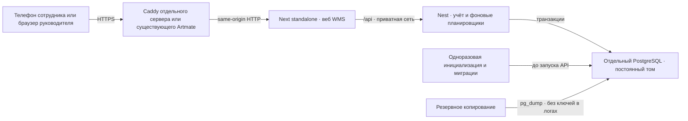

# Устройство релизной инфраструктуры

Отдельный Compose-проект artmate-wms: PostgreSQL17, одноразовая миграция, один API с планировщиками, Next standalone, опциональный Caddy с автоматическим HTTPS. В основной сети доступны только Web/API/DB; наружу выходит только Web через прокси. Для существующего Artmate отдельный overlay подключает только Web к external proxy network, без второго сервиса на 80/443. Web same-origin /api направляет к стабильному compose DNS artmate-wms-api-internal:4080; адрес фиксируется при сборке и не зависит от домена.

Как читать: только прокси принимает внешний трафик. БД и API не публикуют порты. Планировщики запускаются только в одном API, а не при миграциях/сборке.

Production отказывается от тестовых настроек, требует точный HTTPS origin и существующий 32-байтовый master-key. Пустая production БД начинает без demo товара и сотрудников. Existing DB сохраняется; перенос требует прежний master-key. Все резервные копии отдельно от БД, ключ восстанавливается из защищённой копии конфигурации.

Релиз — ручная команда с неизменяемым тегом, backup до изменений, stop writers, миграция, readiness, smoke. Откат образа не откатывает схему. Не запускать второй production scheduler с копией токенов параллельно локальной WMS.
